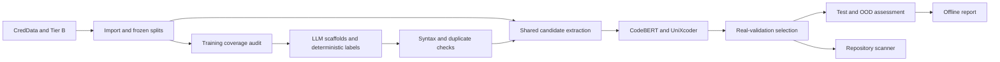

# ISP / DS404 — Secret Detection in Source Code

A complete workflow for detecting credentials in source code and infrastructure configuration: build traceable datasets, generate targeted training examples with a local LLM, train CodeBERT/UniXcoder, evaluate frozen models, scan repositories, and produce offline reports.

This is the project's single maintained README. Supplementary explanations, earlier guides, and detailed history records are kept locally in the ignored `local_docs/` folder, preserving their original directory layout. They are optional reading and are not needed to run a fresh clone.

## Workflow and repository layout



| Location | Contents |
|---|---|
| `secrets_pipeline/` | Current import, generation, training, evaluation, and scanner commands |
| `configs/` | Pilot/full generation, model training, and experiment settings |
| `scripts/` | Environment setup, data/training launchers, and release packaging |
| `Dataset/pipeline_bundle/tier_a/` | Pinned repository manifest, frozen splits, and Tier B generation recipe |
| `Scanner/scanner/` | Shared proposal rules, legacy scanner, and exported CPU ranker |
| `Scanner/evaluation/setup_tools.sh` | Pinned external-detector installation |
| `reporting_bundle/` | Saved-artifact reports, plots, and historical comparison data |
| `tests/`, `reporting_bundle/tests/` | Pipeline and reporting checks |

Downloaded repositories, datasets, environments, model weights, experiment outputs, and report output directories are ignored. A fresh clone contains the source and recipes; restore or regenerate its data and obtain trained model artifacts separately.

## 1. Set up the environment

Run commands from the project root on Linux or WSL. The reference stack uses private Python 3.12 environments; setup can use installed Python 3.12, Conda, or uv without replacing the system Python. Network access is needed for initial dependencies, repository downloads, and pretrained model loading.

```bash
bash scripts/setup_remote.sh all
.venv-train/bin/python -m secrets_pipeline doctor
.venv-train/bin/python -m secrets_pipeline smoke --train --out artifacts/smoke-1
```

`.venv-train` contains parsing, training, evaluation, and scanning dependencies. `.venv-generator` contains vLLM with its own compatible Torch installation. Use `bash scripts/setup_remote.sh data` for data preparation only. Installed environment details are saved under `artifacts/setup/`.

The smoke creates a tiny random local BERT and verifies training, export, reload, and checkpoint resume without downloading model weights. Use a fresh output directory. It tests integration, not detection quality. GPU generation/training also require a compatible NVIDIA driver and sufficient allocated GPU memory.

## 2. Restore or generate the input datasets

Fetch CredData, or use an existing complete checkout:

```bash
bash scripts/fetch_creddata.sh
```

The default destination is `Scanner/datasets/CredData`. Restore the existing Tier B dataset under `Dataset/pipeline_bundle/tier_a/out/tierB`, including its indexed files and label tables. To recreate Tier B from the pinned sources, use the following recipe. Preserve the committed `splits.csv` for comparable experiments.

<details>
<summary>Regenerate Tier B from the repository manifest</summary>

```bash
DATASET=Dataset/pipeline_bundle/tier_a
bash "$DATASET/fetch_repos.sh" "$DATASET/manifest_v2.csv" "$DATASET/repos"

.venv-train/bin/python "$DATASET/pipeline/audit_preexisting.py" \
  --repos "$DATASET/repos" --manifest "$DATASET/manifest_v2.csv" \
  --out "$DATASET/preexisting_hits.csv"
```

Review `preexisting_hits.csv` before generating examples. The exclusion file prevents flagged source files from entering the mutation step.

```bash
.venv-train/bin/python "$DATASET/pipeline/mutate_real.py" \
  --repos "$DATASET/repos" --manifest "$DATASET/manifest_v2.csv" \
  --splits "$DATASET/splits.csv" --out "$DATASET/out/tierB" \
  --exclude-hits "$DATASET/preexisting_hits.csv" \
  --max-files-per-repo 20 --cap-override jenkins=40,pulumi=40

.venv-train/bin/python "$DATASET/pipeline/verify_labels.py" \
  --data "$DATASET/out/tierB"
```

The label check should report zero problems. Inspect fetch failures and generated-file coverage before importing. This recipe creates controlled mutations of real files; retain the source repositories' licence notices with distributed derivatives.

</details>

Import both datasets and audit training coverage:

```bash
.venv-train/bin/python -m secrets_pipeline ingest \
  --creddata Scanner/datasets/CredData \
  --tier-b Dataset/pipeline_bundle/tier_a/out/tierB \
  --out artifacts/import/documents.jsonl \
  --registry artifacts/import/frozen_splits.json \
  --skip-invalid

.venv-train/bin/python -m secrets_pipeline audit \
  --documents artifacts/import/documents.jsonl \
  --out artifacts/import/coverage.json \
  --generation-config artifacts/import/generation-allocation.json
```

`--skip-invalid` quarantines missing, conflicting, or leaking documents instead of failing the whole import. Inspect every reason in the manifest; omit the flag to require a complete valid import. Preserve `frozen_splits.json` with the run. CredData's `snapshot.json` resolves owners where available; `ingest --repo-map mapping.json` accepts a verified mapping for unresolved cases.

## 3. Generate targeted training examples

Start the local generator in a separate terminal. GPU IDs below are examples: select devices allocated to your job.

```bash
GENERATOR_GPUS=4,5 bash scripts/serve_generator.sh
```

The default server is Qwen3-Coder-30B-A3B-Instruct on `127.0.0.1:8000`. Optional settings include `GENERATOR_MODEL`, `GENERATOR_REVISION`, `GENERATOR_PORT`, `GENERATOR_CONTEXT`, and `GENERATOR_MEMORY_FRACTION`. Keep the generation JSON's backend model/endpoint consistent with the server. A compatible local OpenAI-style chat-completions endpoint can also be configured there.

Start with a pilot:

```bash
bash scripts/run_dataset.sh \
  --documents artifacts/import/documents.jsonl \
  --generation-config configs/generation.pilot.json \
  --out artifacts/pilot
```

Inspect `generation/report.json`, accepted examples, rejection reasons, `coverage.before.json`, `coverage.after.json`, and `candidate_coverage.json` under the pilot directory. Review examples for realistic semantics and correct negatives; parser success alone does not establish either.

After the pilot, scale using training-coverage quotas:

```bash
bash scripts/run_dataset.sh \
  --documents artifacts/import/documents.jsonl \
  --generation-config configs/generation.full.json \
  --audit-quotas --target-per-cell 100 --max-cells 304 --max-per-cell 50 \
  --out artifacts/full
```

The LLM writes fictional scaffolds with typed slots. Deterministic insertion supplies the values, exact spans, and related positive/reference/placeholder variants. Filters check syntax, slot integrity, unexpected credential-like literals, duplicates, and leakage. Generated examples are train-only by default. Quotas are requests; accepted counts come from the run report.

An identical rerun reuses completed generation shards. Changed inputs/configuration require a fresh output directory. Keep `generation/plan.json`, shard hashes, and `dataset_status.json`; do not remove manifests to force a resume. Mock generation is for software tests and is refused by normal training.

## 4. Train, compare, and resume

Review the experiment plan before loading models:

```bash
.venv-train/bin/python -m secrets_pipeline experiments \
  --config configs/experiments.json \
  --data artifacts/full/candidates.jsonl \
  --documents artifacts/full/documents.jsonl \
  --out artifacts/experiments --dry-run
```

Run the sequential suite on one allocated GPU:

```bash
TRAIN_GPUS=6 bash scripts/run_experiments.sh \
  --config configs/experiments.json \
  --data artifacts/full/candidates.jsonl \
  --documents artifacts/full/documents.jsonl \
  --out artifacts/experiments
```

The default is 12 runs: CodeBERT/UniXcoder × real-only/augmented × three seeds, plus validation-based selection of an optional probability ensemble. Selection uses real-validation span F1, then candidate AP, unknown-alert burden, and simplicity. Training supports source/class weighting, BF16, gradient accumulation, early stopping, and checkpoint resume. Set `include_mask_ablation=true` in the experiment configuration to also test reliance on assignment key names.

Append `--resume` to the same suite command to continue it. Resume verifies configuration and input hashes and uses completed epoch checkpoints; an interrupted epoch restarts. Keep the entire output directory when transferring runs.

For one model across multiple GPUs, use `TRAIN_GPUS=4,5 bash scripts/train_model.sh --config configs/train.codebert.json --data artifacts/full/candidates.jsonl --out artifacts/codebert-ddp`. Append `--resume artifacts/codebert-ddp` to resume that run; keep the worker count and optimization schedule unchanged. Stop a generator first if reusing its GPU allocation.

The suite produces `selected.json`, `leaderboard.json`, per-run metadata, checkpoints, and exported `best/` weights/tokenizers. Thresholds are chosen on validation only. Automatic BLOCK remains disabled when validation does not support the required precision lower bound; WARN can still be used.

## 5. Assess frozen models and scanner baselines

After selecting the model, evaluate test and OOD separately:

```bash
.venv-train/bin/python -m secrets_pipeline assess \
  --bundle artifacts/experiments/selected.json \
  --documents artifacts/full/documents.jsonl \
  --data artifacts/full/candidates.jsonl \
  --split test --out artifacts/test --bootstrap-samples 500

.venv-train/bin/python -m secrets_pipeline assess \
  --bundle artifacts/experiments/selected.json \
  --documents artifacts/full/documents.jsonl \
  --data artifacts/full/candidates.jsonl \
  --split test_ood --out artifacts/test-ood --bootstrap-samples 500
```

For current same-corpus baselines, install the pinned detector tools into the active environment and run:

```bash
source .venv-train/bin/activate
bash Scanner/evaluation/setup_tools.sh

.venv-train/bin/python -m secrets_pipeline baselines \
  --documents artifacts/full/documents.jsonl --split test \
  --tools legacy,gitleaks,trufflehog --out artifacts/baselines-test
```

Repeat with `--split test_ood --out artifacts/baselines-test-ood` for OOD. Executables live under `Scanner/tools/bin/`; `--gitleaks` and `--trufflehog` accept alternative paths. If transferred binaries lost executable permission, restore it with `chmod u+x Scanner/tools/bin/gitleaks Scanner/tools/bin/trufflehog`. Baselines do not verify credentials over the network.

The headline is `warn.headline_real_test`. End-to-end span scoring includes annotated secrets missed by candidate extraction. Candidate-classification statistics cover only explicitly labeled proposals. Unknown-region alerts remain review burden, not certified false positives. The legacy learned ranker may overlap with newer test repositories; shared scoring does not remove that limitation.

## 6. Scan a repository

```bash
.venv-train/bin/python -m secrets_pipeline scan /path/to/project \
  --bundle artifacts/experiments/selected.json --out artifacts/project-scan.json
```

Use `--legacy` instead of `--bundle ...` for the shipped CPU ranker. Exit codes are **0** for PASS/WARN, **1** for BLOCK, and **2** for incomplete/error. Findings redact credential values; read/size failures prevent a false clean result. Keep the matching scanner/rule files with exported bundles so calibrated preprocessing remains consistent.

For training-only error review, use `predict --model-dir RUN --data CANDIDATES --split train --out PREDICTIONS`, then `mine --data CANDIDATES --predictions PREDICTIONS --threshold 0.5 --out REVIEW` through `.venv-train/bin/python -m secrets_pipeline`. The review threshold is illustrative. Mining does not assign new labels; do not tune the same experiment on held-out errors.

## 7. Generate the report

Reporting reads completed artifacts on CPU; it does not retrain, download a model, or run new inference.

```bash
.venv-train/bin/python -m pip install -r reporting_bundle/requirements.txt
bash reporting_bundle/run_report.sh
```

Keep these matching inputs together:

| Directory | Required saved inputs |
|---|---|
| `artifacts/full/` | `documents.jsonl`, `candidates.jsonl` |
| `artifacts/experiments/` | `selected.json`, `leaderboard.json`, `suite_manifest.json`, and all leaderboard run directories |
| `artifacts/experiments/runs/<run>/` | `run.json`, history, and selected members' `real_validation_all_predictions.jsonl`; exported `best/config.json` supplies architecture detail |
| `artifacts/test/`, `artifacts/test-ood/` | `metrics.json`, `predictions.jsonl` |

Generation/coverage files and `artifacts/baselines-test*` are optional. Reporting does not load weight files, but copying only `selected.json` and model weights is insufficient. Retain the matching `secrets_pipeline/` code for recomputing span metrics.

The default output is a fresh `reporting_bundle/output/report-<UTC timestamp>/`. Open `report.html` offline; PNG plots are embedded. The output also contains structured JSON, CSV tables, PNG/SVG figures, and a generated report narrative. Missing/undefined metrics remain unavailable.

For another complete artifact layout:

```bash
bash reporting_bundle/run_report.sh \
  --experiments artifacts/experiments-v2 --dataset artifacts/full-v2 \
  --test artifacts/test-v2 --test-ood artifacts/test-ood-v2 \
  --baselines artifacts/baselines-test-v2 artifacts/baselines-test-ood-v2 \
  --out artifacts/final-report-v2
```

Relative paths resolve from the project root. Choose a new output directory; nonempty outputs are refused. `REPORT_PYTHON=/path/to/python` selects another interpreter with reporting dependencies installed. `--baselines` with no directories skips optional baseline discovery. `--allow-partial` explicitly creates an incomplete report for missing inputs; it does not bypass corrupt data, mismatched corpora, or changed thresholds. Use `--help` for all flags.

## 8. Tests and source packaging

```bash
.venv-train/bin/python -m unittest discover -s tests -v
.venv-train/bin/python -m unittest discover -s reporting_bundle/tests -v
.venv-train/bin/python scripts/package_release.py --out artifacts/ISP-pipeline.zip
```

The portable source archive opens under `ISP/`. Recreate environments after extraction and transfer required datasets/model outputs separately. Local notes, caches, downloaded inputs, and experiment outputs are excluded from the source package. Use a new archive filename for each release.

## Methodology and result interpretation

CredData `T`/`F` labels remain positive/negative; `X` and unannotated content remain unknown. Ambiguous coarse positive lines with several candidates are excluded from candidate supervision, while the original annotation remains in end-to-end evaluation. Existing Tier B splits remain frozen; newly assigned owners use deterministic 70/15/15 train/validation/test allocation. Jenkins/Pulumi Tier B examples form separate OOD data. Generation quotas use training data only.

The project owner reported completing remote experiments and assessments. Their transformer weights and actual scores are separate artifacts; this checkout does not claim a new remote performance result. Software tests use fixtures, and the training smoke uses a tiny random model. Read measured outcomes from the matching `selected.json` and assessment outputs.

Historical scanner measurements are retained in [historical_results.json](reporting_bundle/data/historical_results.json) and included in reports. Their line-based scoring, splits, thresholds, UUID policy, and possible development overlap differ from current span evaluation; they cannot establish a controlled improvement over the new model. Repository-bootstrap intervals require real-source repositories; a Tier B-only OOD split has no real-repository interval. Seed variability describes validation runs, not test confidence intervals.

## Contributors

File references identify maintained implementations; earlier versions and supporting documentation remain available in Git history. Shared work and upstream attribution are retained.

| Contributor | Contribution |
|---|---|
| [saurav10codes](https://github.com/saurav10codes) | **Training pipeline:** original boosted ranker/export, earlier encoder preparation, and current weighted CodeBERT/UniXcoder training, calibration, checkpoint/resume, and export in [train.py](secrets_pipeline/train.py), [metrics.py](secrets_pipeline/metrics.py), [train_model.sh](scripts/train_model.sh), and [smoke_train.py](secrets_pipeline/smoke_train.py). Shared experiment-suite training integration. |
| [iashrkr23](https://github.com/iashrkr23) | **Scanner development:** legacy extraction, scoring, filtering, and CI gates in [Scanner/scanner/scan.py](Scanner/scanner/scan.py); shared candidate integration in [candidates.py](secrets_pipeline/candidates.py) and deployment integration in [scan.py](secrets_pipeline/scan.py). |
| [KDS-7Git](https://github.com/KDS-7Git) | **Scanner and repository selection, broader scope:** pinned source catalogue and fetching, source-content audit, provider [rules](Scanner/scanner/rules.toml), label-independent [candidates](secrets_pipeline/candidates.py), and training-coverage/quota [audit](secrets_pipeline/audit.py). The maintained repository input is [manifest_v2.csv](Dataset/pipeline_bundle/tier_a/manifest_v2.csv); the earlier expansion catalogue is retained as background material. |
| [titanansh-excel](https://github.com/titanansh-excel) | **Testing and evaluation verification:** generated-label consistency, external-detector setup, and [pipeline tests](tests/) for leakage, generation rejection, missing proposals, calibration, resume integrity, baseline failures, and workflow smoke; [reporting tests](reporting_bundle/tests/test_reporting.py) cover consistency, comparisons, and redaction. |
| [Aditya-Chandel108](https://github.com/Aditya-Chandel108) | **Evaluation, comparison, and reporting:** earlier benchmark protocols, current one-to-one span [evaluation](secrets_pipeline/evaluate.py), repository bootstrap, [frozen assessment](secrets_pipeline/assess.py), [baseline adapters](secrets_pipeline/baselines.py), multi-seed/augmentation/ensemble [experiments](secrets_pipeline/experiments.py), and reporting statistics, plots, and artifact validation. |
| [AliYasoob-tech](https://github.com/AliYasoob-tech) | **Dataset generation:** typed values, placeholders, references, and look-alike negatives in [secrets_lib.py](Dataset/pipeline_bundle/tier_a/pipeline/secrets_lib.py); earlier scaffold generation; current local-generator requests, deterministic spans/counterfactuals, resumable shards in [generate.py](secrets_pipeline/generate.py), and the [pilot profile](configs/generation.pilot.json). |
| [Prashant-900](https://github.com/Prashant-900) | **Dataset pipeline and integration, broader scope:** owner-grouped splits and controlled real-file mutations; generation backend integration; canonical [schema](secrets_pipeline/schema.py), [import/quarantine](secrets_pipeline/ingest.py), [workflow orchestration](secrets_pipeline/workflow.py), CLI/environment setup, and integration merges. |
| [mananmeemroth](https://github.com/mananmeemroth) | **Model-backed scanner:** saved-model loading and reproducible [prediction](secrets_pipeline/predict.py), calibrated [scanner](secrets_pipeline/scan.py) bundles, redacted findings and failure handling, plus training-only error-review queues in [mine.py](secrets_pipeline/mine.py). Scanner integration is shared with iashrkr23. |
| [FlameBoY01-OG](https://github.com/FlameBoY01-OG) | **Dataset expansion and validation:** earlier semantic-edit generation, current format/credential [taxonomy](secrets_pipeline/taxonomy.py), [syntax/span/duplicate validation](secrets_pipeline/validation.py), [full-generation settings](configs/generation.full.json), generator dependencies, and [local model serving](scripts/serve_generator.sh). |
| [Deepak-IITian07](https://github.com/Deepak-IITian07) | **Smaller release/documentation support scope:** [source packaging](scripts/package_release.py), [report launcher](reporting_bundle/run_report.sh), reporting dependencies/output exclusions, and assembly of project explanations, operational guides, and contributor/history records. |

## Project history and upstream credit

**Project period:** 11 September–5 November 2026, Asia/Kolkata. The Git history contains 43 contribution milestones and 21 integration merges across 21 topic branches plus `main`. Topic branches use `<contributor>/<topic>` names.

```bash
git log --graph --oneline --decorate --all
```

All ten contributors have author commits in that history. GitHub account association depends on recognized commit emails; iashrkr23 uses `229318849+iashrkr23@users.noreply.github.com`. Contributor records do not replace upstream ownership or establish model-performance evidence.

The rule database credits [Gitleaks](https://github.com/gitleaks/gitleaks), [detect-secrets](https://github.com/Yelp/detect-secrets), [git-secrets](https://github.com/awslabs/git-secrets), and [secrets-patterns-db](https://github.com/mazen160/secrets-patterns-db), alongside project-specific IaC/CI rules. Preserve the provenance comments in [rules.toml](Scanner/scanner/rules.toml). CredData and repository-derived examples retain their original annotations and provenance; keep source licence notices with distributed derivatives.
