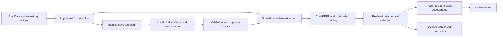

# ISP / DS404 — Secret Detection in Source Code

A repository-to-report workflow for detecting credentials in source code and infrastructure configuration. The project combines an IaC-aware scanner, reproducible dataset recipes, local-LLM data generation, CodeBERT/UniXcoder training, held-out evaluation, and an offline reporting bundle.

**Project period:** 11 September–5 November 2026, Asia/Kolkata.

The Git history contains **43 contribution milestones and 21 integration merges: 64 commits reachable from `main`**, with **21 contributor topic branches plus `main`**. Topic branches include parallel work and three branches started from other feature branches. The [branch map](docs/HISTORY.md#branches-and-integration) records their milestones, branch points and merge dates. Contribution counts below refer to the 43 milestones; integration merges are attributed to Prashant-900.

## What the project contains

- **Legacy scanner:** provider patterns, context and placeholder checks, plus a learned gradient-boosted ranker. The exported CPU model is retained in `Scanner/scanner/model_v2.json`.
- **Dataset recipes:** pinned repository manifests, owner-grouped splits, typed secret values, controlled mutations, label checks and earlier LLM generation tools.
- **Current data pipeline:** CredData/Tier B import with provenance, frozen splits, training-only coverage audits, scaffold generation, exact-span insertion, syntax validation and duplicate rejection.
- **Model pipeline:** shared candidate extraction, CodeBERT and UniXcoder classifiers, weighted training, checkpoint resume, validation-selected thresholds, model comparison and an optional probability ensemble.
- **Evaluation and reports:** end-to-end span scoring, missed-candidate accounting, unknown-alert burden, separate real/OOD results, external scanner adapters, and HTML/Markdown/CSV/JSON/PNG/SVG reporting.



The LLM writes scaffolds; deterministic code inserts the labeled values. Unknown content remains unknown. Evaluation includes annotated secrets that candidate extraction missed. Generation and model selection use training/validation data, while the final real test and OOD populations remain separate.

## Start here

Run the commands below from the **project root** on Linux, or WSL on Windows. The complete workflow, GPU allocation, dataset generation, training, resume, evaluation and scanning commands are in the [runbook](docs/RUNBOOK.md).

```bash
bash scripts/setup_remote.sh all
.venv-train/bin/python -m secrets_pipeline doctor
.venv-train/bin/python -m unittest discover -s tests -v
.venv-train/bin/python -m secrets_pipeline smoke --train --out artifacts/smoke-1
```

Setup creates separate Python 3.12 training and generator environments. The smoke uses a tiny local random BERT and checks training/export/resume without downloading a pretrained model. Use a fresh smoke output directory. Passing the smoke establishes framework integration, not detection quality.

**A fresh clone contains source and recipes.** Downloaded repositories, generated files under `Dataset/pipeline_bundle/tier_a/out/`, scanner executables, environments, and experiment outputs are ignored. Restore the existing Tier B dataset or regenerate it using [Dataset/README.md](Dataset/README.md), starting at `Dataset/pipeline_bundle/tier_a/` and preserving committed splits. Obtain CredData with `bash scripts/fetch_creddata.sh`. The [runbook's import section](docs/RUNBOOK.md#3-obtainimport-the-original-data-and-audit-it) explains how these inputs are combined.

For external scanner comparisons, install the pinned tools with the training environment active:

```bash
source .venv-train/bin/activate
bash Scanner/evaluation/setup_tools.sh
```

This creates the local Gitleaks/TruffleHog executables under `Scanner/tools/bin/` and installs evaluation dependencies into the active environment.

### Generate a report from completed remote experiments

The project owner reported completing the remote experiment suite and the `test` and `test_ood` assessments. Their selected transformer weights and actual scores are not included in this source checkout. Keep the matching remote dataset, experiment and assessment artifacts together, then run:

```bash
.venv-train/bin/python -m pip install -r reporting_bundle/requirements.txt
bash reporting_bundle/run_report.sh
```

The report reads saved outputs and needs no retraining or new inference. Open the generated `report.html`; plots are embedded for offline use. Required inputs, alternative paths and optional baseline runs are documented in [reporting_bundle/README.md](reporting_bundle/README.md).

## Repository guide

| Location | Purpose |
|---|---|
| [`Dataset/`](Dataset/README.md) | Earlier Tier A/B/C recipes, pinned manifests, frozen splits, mutation and generation tools |
| [`Scanner/scanner/`](Scanner/scanner/scan.py) | Legacy scanner, provider rules and exported CPU ranker |
| [`Scanner/evaluation/`](Scanner/evaluation/README_TESTING.md) | Historical evaluation harness and pinned detector setup |
| [`secrets_pipeline/`](secrets_pipeline/__main__.py) | Current import → generation → training → evaluation → scanning workflow |
| [`configs/`](configs/experiments.json) | Pilot/full generation and model/experiment settings |
| [`scripts/`](scripts/setup_remote.sh) | Environment setup, dataset/training launchers and release packaging |
| [`tests/`](tests/test_workflow.py) | Data, generation, training, experiment, baseline and workflow checks |
| [`reporting_bundle/`](reporting_bundle/README.md) | Saved-artifact reporting, plots, comparisons and reporting tests |
| [`docs/RUNBOOK.md`](docs/RUNBOOK.md) | Complete operational commands and artifact guidance |
| [`docs/HISTORY.md`](docs/HISTORY.md) | Development milestones and contributor records |
| [`docs/contributors.json`](docs/contributors.json) | Machine-readable contributor records |

## Contributors

The table summarizes contributor responsibilities; detailed scope and file references follow. Shared areas can involve more than one contributor, and upstream code and pattern authors retain their own credits.

| Contributor | Contribution area |
|---|---|
| [saurav10codes](https://github.com/saurav10codes) | Training pipeline and model export |
| [iashrkr23](https://github.com/iashrkr23) | Core scanner development and shared scanner integration |
| [KDS-7Git](https://github.com/KDS-7Git) | Scanner rules, candidate extraction and dataset repository selection; broader scope |
| [titanansh-excel](https://github.com/titanansh-excel) | Testing, evaluation setup and verification |
| [Aditya-Chandel108](https://github.com/Aditya-Chandel108) | Evaluation methodology, model comparison and reporting |
| [AliYasoob-tech](https://github.com/AliYasoob-tech) | Dataset generation and typed secret insertion |
| [Prashant-900](https://github.com/Prashant-900) | Dataset construction, ingestion and workflow integration; broader scope |
| [mananmeemroth](https://github.com/mananmeemroth) | Model-backed scanning, prediction and review tooling |
| [FlameBoY01-OG](https://github.com/FlameBoY01-OG) | Dataset expansion, validation and generator deployment |
| [Deepak-IITian07](https://github.com/Deepak-IITian07) | Smaller release-packaging and documentation support scope |

### saurav10codes — Training pipeline

- Training and export for the historical scanner ranker: [`Scanner/training/train_v2.py`](Scanner/training/train_v2.py) and its retained [`model_v2.json`](Scanner/scanner/model_v2.json).
- Earlier encoder input preparation and fine-tuning: [`gpu/common.py`](Dataset/pipeline_bundle/tier_a/pipeline/gpu/common.py) and [`gpu/train_codebert.py`](Dataset/pipeline_bundle/tier_a/pipeline/gpu/train_codebert.py).
- Current weighted classifier training, calibration, checkpoint/resume and model export: [`train.py`](secrets_pipeline/train.py), [`metrics.py`](secrets_pipeline/metrics.py), [`train.codebert.json`](configs/train.codebert.json), [`requirements/train.txt`](requirements/train.txt) and [`train_model.sh`](scripts/train_model.sh). This scope includes BF16 training, gradient accumulation, early stopping and frozen operating points.
- Framework integration verification in [`smoke_train.py`](secrets_pipeline/smoke_train.py), with shared responsibility for training integration in the experiment suite. Attribution to these files does not assert a particular measured remote score.

### iashrkr23 — Scanner development

- Primary legacy scanner implementation in [`Scanner/scanner/scan.py`](Scanner/scanner/scan.py): traversal, extraction, scoring, filtering and scanner output behavior.
- Shared integration work connecting legacy rule proposals to the current [`candidates.py`](secrets_pipeline/candidates.py) preprocessing layer.
- Shared scanner deployment work in [`secrets_pipeline/scan.py`](secrets_pipeline/scan.py), connecting extracted candidates to saved model scores and WARN/BLOCK decisions.

### KDS-7Git — Scanner and repository selection

- Scanner and repository-selection work covers pinned source catalogues in [`manifest.csv`](Dataset/pipeline_bundle/tier_a/manifest.csv), [`manifest_v2.csv`](Dataset/pipeline_bundle/tier_a/manifest_v2.csv), [`fetch_repos.sh`](Dataset/pipeline_bundle/tier_a/fetch_repos.sh) and [`creddata_seed_repos.json`](creddata_seed_repos.json).
- Provider-rule curation and scanner configuration in [`rules.toml`](Scanner/scanner/rules.toml), retaining its stated upstream pattern provenance.
- Existing-content review support through [`audit_preexisting.py`](Dataset/pipeline_bundle/tier_a/pipeline/audit_preexisting.py), plus label-independent proposal discovery and coverage measurement in [`candidates.py`](secrets_pipeline/candidates.py).
- Training-only coverage summaries and generation allocation in [`audit.py`](secrets_pipeline/audit.py). Catalogue entries identify proposed sources; they do not by themselves prove a repository was fetched or included in a dataset.

### titanansh-excel — Testing and evaluation verification

- Independent generated-label consistency checks in [`verify_labels.py`](Dataset/pipeline_bundle/tier_a/pipeline/verify_labels.py).
- Historical evaluation execution support: [`setup_tools.sh`](Scanner/evaluation/setup_tools.sh), [`run_all.sh`](Scanner/evaluation/run_all.sh), [`get_creddata.sh`](Scanner/evaluation/get_creddata.sh), [`subset_creddata.py`](Scanner/evaluation/subset_creddata.py) and [`README_TESTING.md`](Scanner/evaluation/README_TESTING.md).
- Regression coverage across [`test_data.py`](tests/test_data.py), [`test_generation.py`](tests/test_generation.py), [`test_training.py`](tests/test_training.py), [`test_experiments.py`](tests/test_experiments.py), [`test_baselines.py`](tests/test_baselines.py) and [`test_workflow.py`](tests/test_workflow.py). Areas include leakage checks, missing proposals, threshold behavior, resume integrity, adapter failures and redaction.
- End-to-end software smoke coverage in [`smoke.py`](secrets_pipeline/smoke.py), plus [`reporting tests`](reporting_bundle/tests/test_reporting.py) and the scope of local checks recorded in [`VERIFICATION.md`](reporting_bundle/VERIFICATION.md).

### Aditya-Chandel108 — Evaluation and comparison

- Earlier dataset scoring and the LLM baseline: [`Dataset/.../evaluate.py`](Dataset/pipeline_bundle/tier_a/pipeline/evaluate.py) and [`llm_baseline.py`](Dataset/pipeline_bundle/tier_a/pipeline/gpu/llm_baseline.py); historical scanner evaluation in [`evaluate_all.py`](Scanner/evaluation/evaluate_all.py), aggregate results and [`V2_REPORT.md`](Scanner/V2_REPORT.md).
- Current one-to-one span evaluation and repository bootstrap in [`evaluate.py`](secrets_pipeline/evaluate.py); frozen model assessment and external-detector normalization in [`assess.py`](secrets_pipeline/assess.py) and [`baselines.py`](secrets_pipeline/baselines.py).
- Real-only versus augmented model comparison, multiple seeds and optional ensemble selection in [`experiments.py`](secrets_pipeline/experiments.py), [`experiments.json`](configs/experiments.json) and [`run_experiments.sh`](scripts/run_experiments.sh), with training integration shared with saurav10codes.
- Reporting statistics, figures and artifact checks in [`report_stats.py`](reporting_bundle/report_stats.py), [`plotting.py`](reporting_bundle/plotting.py) and [`build_report.py`](reporting_bundle/build_report.py), alongside the historical results appendix and structured result tables. Current and historical protocols remain explicitly separated.

### AliYasoob-tech — Dataset generation

- Typed secret values, placeholders, references and look-alike negatives in [`secrets_lib.py`](Dataset/pipeline_bundle/tier_a/pipeline/secrets_lib.py).
- Earlier scaffold generation and slot filling in [`gen_skeletons.py`](Dataset/pipeline_bundle/tier_a/pipeline/gpu/gen_skeletons.py).
- Current local-generator requests, deterministic inserted spans, related positive/reference/placeholder variants and resumable generation shards in [`generate.py`](secrets_pipeline/generate.py).
- Small-run generation settings in [`generation.pilot.json`](configs/generation.pilot.json), enabling inspection of acceptance/rejection behavior before requesting a larger corpus.

### Prashant-900 — Dataset pipeline and integration

- Dataset-pipeline work includes project bootstrap, owner-grouped splitting in [`make_split.py`](Dataset/pipeline_bundle/tier_a/pipeline/make_split.py), the frozen [`splits.csv`](Dataset/pipeline_bundle/tier_a/splits.csv), and controlled real-file mutation in [`mutate_real.py`](Dataset/pipeline_bundle/tier_a/pipeline/mutate_real.py).
- Earlier generation backend integration in [`llm_backend.py`](Dataset/pipeline_bundle/tier_a/pipeline/gpu/llm_backend.py), dataset dependencies and dataset run instructions.
- Canonical document/span structures, provenance, import and quarantine handling through [`schema.py`](secrets_pipeline/schema.py) and [`ingest.py`](secrets_pipeline/ingest.py), supported by [`requirements/data.txt`](requirements/data.txt) and [`fetch_creddata.sh`](scripts/fetch_creddata.sh).
- Import/audit/generation/candidate orchestration in [`workflow.py`](secrets_pipeline/workflow.py) and [`run_dataset.sh`](scripts/run_dataset.sh), plus package/CLI integration, [`doctor.py`](secrets_pipeline/doctor.py) and [`setup_remote.sh`](scripts/setup_remote.sh).

### mananmeemroth — Model-backed scanner

- Saved-model loading, consistent preprocessing and candidate probability inference in [`predict.py`](secrets_pipeline/predict.py).
- Deployment scanner integration in [`secrets_pipeline/scan.py`](secrets_pipeline/scan.py): bundle loading, file handling, score aggregation, saved thresholds, redacted findings and CI exit codes, with scanner integration shared with iashrkr23.
- Training-only error-review queues in [`mine.py`](secrets_pipeline/mine.py). Mining produces review candidates; it does not automatically certify new labels.

### FlameBoY01-OG — Dataset expansion and validation

- Earlier label-preserving LLM editing tools in [`semantic_edits.py`](Dataset/pipeline_bundle/tier_a/pipeline/gpu/semantic_edits.py).
- Generation families, credential types and variation settings in [`taxonomy.py`](secrets_pipeline/taxonomy.py), plus syntax/span checks and value-masked duplicate detection in [`validation.py`](secrets_pipeline/validation.py).
- Larger generation settings in [`generation.full.json`](configs/generation.full.json), generator dependencies in [`requirements/generator.txt`](requirements/generator.txt) and local model serving through [`serve_generator.sh`](scripts/serve_generator.sh).
- This work covers expansion recipes and validation behavior. Requested generation quotas are configuration values; accepted dataset sizes come from a completed run's generation report.

### Deepak-IITian07 — Release and documentation support

- Release support covering portable archive creation in [`package_release.py`](scripts/package_release.py) and report-output exclusions in [`reporting_bundle/.gitignore`](reporting_bundle/.gitignore).
- Report launch/setup instructions through [`run_report.sh`](reporting_bundle/run_report.sh), reporting dependencies and the reporting README.
- Assembly of [`PROJECT_EXPLAINED.md`](reporting_bundle/PROJECT_EXPLAINED.md), this project overview, the [runbook](docs/RUNBOOK.md), and contributor/history records. This role supports packaging and presentation of the existing implementation.

GitHub associates commit authors with recognized commit email addresses; the displayed author name alone does not establish that association. The profile links above identify all ten contributors. Email configuration is recorded in [contributors.json](docs/contributors.json) and [HISTORY.md](docs/HISTORY.md).

## Evidence and testing

Run the existing checks in a configured environment:

```bash
.venv-train/bin/python -m unittest discover -s tests -v
.venv-train/bin/python -m unittest discover -s reporting_bundle/tests -v
```

The reporting bundle's [verification record](reporting_bundle/VERIFICATION.md) describes local software tests with fictional fixtures. Remote model performance must come from `selected.json`, the matching frozen input corpus, and saved assessment outputs. Missing metrics remain unavailable. Automatic BLOCK remains disabled when real validation does not support its precision requirement.

[Historical scanner results](reporting_bundle/HISTORICAL_RESULTS.md) retain the older line-based measurements, thresholds and limitations. Those scores use different protocols and cannot establish a controlled improvement over the current span evaluator. The [complete project explanation](reporting_bundle/PROJECT_EXPLAINED.md) connects implementation, methodology and interpretation.

## Upstream credit and data provenance

The rule database records patterns originating from [Gitleaks](https://github.com/gitleaks/gitleaks), [detect-secrets](https://github.com/Yelp/detect-secrets), [git-secrets](https://github.com/awslabs/git-secrets) and [secrets-patterns-db](https://github.com/mazen160/secrets-patterns-db), together with project-specific IaC/CI rules. Preserve the source annotations in [`rules.toml`](Scanner/scanner/rules.toml); team attribution does not replace upstream authorship or licensing terms.

CredData imports and repository-derived examples retain their source annotations and provenance. Keep the original repository licence notices when distributing derived data. The committed manifests and generator recipes describe reproducible inputs; generated datasets, downloaded repositories and model-training artifacts are distributed separately from the source history.
