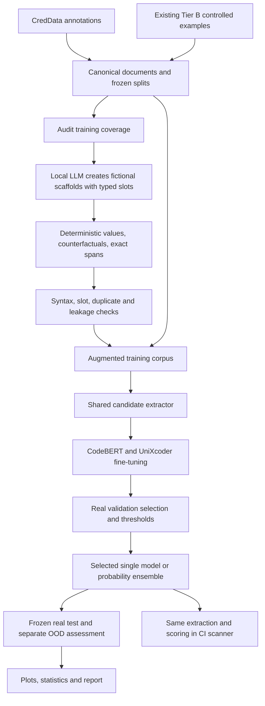
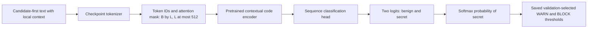

# How the secrets-detection project works

This document explains the implementation in this project, from the original scanner to dataset generation, deep-learning training, model selection, testing, and CI use. The companion [README](README.md) explains how to generate a report from the artifacts on the remote machine.

The user reported completing the experiment suite and both `test` and `test_ood` assessments. This document describes what those commands do. Actual remote scores, accepted dataset sizes, winning model, and training times must come from the saved remote artifacts; they are not inferred from the configuration or from earlier scanner scores.

## 1. Objective and development stages

The objective is to find exposed passwords, API keys, tokens, private keys, and other credential values in source code and infrastructure configuration. The detector must also distinguish these values from placeholders, environment-variable references, hashes, public identifiers, and other benign lookalikes. The final scanner assigns PASS, WARN, or BLOCK so that CI can stop a build containing a sufficiently confident finding.

The project developed in three main stages:

1. A CPU scanner combines provider patterns, generic candidate extraction, context features, and a gradient-boosted ranking model.
2. The original `Dataset/` pipeline creates controlled infrastructure-as-code examples by modifying pinned public repositories and recording deterministic labels.
3. The newer `secrets_pipeline/` package imports CredData and the existing Tier B examples, extends training diversity with a local LLM, fine-tunes contextual code encoders, selects a model using real validation data, and evaluates frozen test splits.

The third stage is the workflow used by `scripts/run_experiments.sh` and the two `secrets_pipeline assess` commands. Older scripts under `Dataset/pipeline_bundle/tier_a/pipeline/gpu/` are a separate earlier implementation; their existence does not mean they were run as part of this experiment suite.



## 2. How the original scanner was built

The original scanner implementation is [`Scanner/scanner/scan.py`](../Scanner/scanner/scan.py). Its bundled [`rules.toml`](../Scanner/scanner/rules.toml) records these sources in its header:

- Gitleaks upstream configuration, with Go patterns converted for Python.
- detect-secrets keyword patterns.
- git-secrets AWS patterns.
- secrets-patterns-db patterns.
- Custom infrastructure and CI patterns.

These source comments document the rule database's stated provenance. They are not evidence that this project reimplemented every upstream detector, or that the exact upstream versions used in historical benchmark runs match the rule database version. Preserve the rules and their provenance when distributing the project.

The bundled scanner has 260 rules and a learned v2 ranker. Its processing stages are:

1. **Propose candidates.** Apply the matching rule's configured secret capture group; add PEM, Basic/Bearer authentication, URL-password, PASETO and NATS NKey patterns; extract suspicious assignments and calls; and search high-entropy strings. CamelCase key tokenization helps recognize names such as `domainPassword`.
2. **Filter clear benign values.** Remove recognized placeholders and references before the legacy ranking stage.
3. **Build 197 numeric features.** Features describe length, entropy, character composition, encoding/shape, assignment-key words, detector source, separators, line and previous-line context, and file extension.
4. **Apply gradient-boosted trees.** The 300-tree model in [`model_v2.json`](../Scanner/scanner/model_v2.json) is exported for pure-Python inference. Recognized provider patterns retain a confidence floor in this legacy scoring path.
5. **Assign a verdict.** The shipped legacy model uses WARN at 0.24 and BLOCK at 0.45. Earlier result tables also contain runs at 0.40/0.70, so always quote the threshold associated with the particular experiment.

The v2 development report explains why simply using more regular expressions was insufficient: low-entropy or short passwords were missed, while generic patterns flagged dates, ordinary identifiers, type declarations, and references. The capture-group correction and learned context ranker addressed different parts of that problem. See [`Scanner/V2_REPORT.md`](../Scanner/V2_REPORT.md).

## 3. Why extend CredData

CredData supplies real repository contexts and annotated credential/non-credential spans, but a particular imported training subset may have limited coverage of infrastructure formats, credential types, low-entropy passwords, naming styles, or hard negatives. The new workflow measures those gaps before requesting synthetic data.

[`audit.py`](../secrets_pipeline/audit.py) reports source/split composition, categories, languages/families, repositories/groups, labels, and mapped family-by-secret-type coverage. Only positive spans in the **training split** influence generation quotas. A zero in a mapped cell means no mapped evidence in the supplied training subset; it does not prove that the full CredData collection lacks that case. Uncertain category mappings are reported separately.

The seed catalogue [`creddata_seed_repos.json`](../creddata_seed_repos.json) is an expansion catalogue. Reading it does not download those repositories or demonstrate that they contributed examples to a run.

## 4. Import, annotations and frozen splits

[`ingest.py`](../secrets_pipeline/ingest.py) converts both input sources into `documents.jsonl`. Each document carries its text, path, language, source, repository ID, grouping ID, split, and explicit labeled spans. Offsets are zero-based Unicode character offsets with an exclusive end; they are not byte offsets.

For CredData:

- `T` becomes an explicit positive and `F` an explicit negative.
- `X` and unannotated text remain unknown.
- Original UUID labels are preserved. This differs from one historical v2 benchmark that excluded UUID-only positives.
- Exact value annotations are used when available. Coarse line/range annotations retain that provenance.
- If a coarse positive overlaps several proposals, it is ambiguous which candidate is the credential. The workflow excludes ambiguous candidate supervision instead of labeling every overlapping string positive. The positive annotation remains in document-level evaluation, where it can still be missed.

For Tier B, line fragments belonging to the same injected `span_id` are joined into a semantic span. This is especially important for a multiline private key, which should not be counted as dozens of independent credentials.

Existing split assignments are preserved. New owner groups receive a deterministic 70/15/15 train/validation/test assignment. The persistent registry is saved as `artifacts/import/frozen_splits.json`. Where CredData owners cannot be resolved from `snapshot.json` or an explicit repository mapping, grouping falls back to the repository ID; the import manifest reports that owner-level separation is then not guaranteed for those records.

The existing Tier B manifest describes 104 repositories with 65 train, 10 validation, 22 test, and 7 `test_ood` repositories. Jenkins and Pulumi form the Tier B OOD group. These are historical manifest counts, not a promise about the final accepted remote corpus after quarantine and duplicate checks.

The corpus validator checks conflicting labels, invalid spans, duplicate IDs, repository/group leakage, exact content duplicates, masked-template duplicates, and cross-split near duplicates. With `--skip-invalid`, import quarantines problematic documents and records why; it does not silently repair labels. Held-out documents receive priority when duplicates must be quarantined. These checks reduce leakage; unresolved ownership, semantic near duplicates, and annotation quality still limit what can be guaranteed.

Sources: [`schema.py`](../secrets_pipeline/schema.py), [`ingest.py`](../secrets_pipeline/ingest.py), and [`Dataset/README.md`](../Dataset/README.md).

## 5. Local-LLM generation with deterministic ground truth

The configured generator is `Qwen/Qwen3-Coder-30B-A3B-Instruct`, accessed through a local OpenAI-compatible HTTP endpoint. The server script uses vLLM by default. The generator is used to write scaffolds; the project does not fine-tune it in this workflow.

The full generation configuration targets 16 training families: Terraform, Kubernetes, Helm, Ansible, Compose, GitHub Actions, CloudFormation, dotenv, TOML, JSON configuration, INI, XML, Python, JavaScript, Java, and Go. The taxonomy also includes Jenkins and Pulumi, which are reserved from default training generation. It defines 19 credential types, including low-entropy/random passwords, opaque tokens, provider keys, JWTs, connection strings, encoded secrets, Basic authentication, and private keys. Key hints, locales, and layout styles add further variation.

The procedure in [`generate.py`](../secrets_pipeline/generate.py) is:

1. Construct a plan from family/type/topic specifications and a reproducible seed.
2. Ask the LLM for fictional source containing quoted typed markers such as `@@SECRET:...@@`, `@@REFERENCE:...@@`, `@@PLACEHOLDER:...@@`, `@@HASH:...@@`, `@@ID:...@@`, and `@@PUBLIC:...@@`.
3. Validate marker integrity and reject unexpected credential-like literals.
4. Generate fictional values deterministically in code. Private keys are generated locally and are never installed as operational credentials.
5. Create related **secret**, **reference**, and **placeholder** variants from the same scaffold. Record positive and benign spans while constructing the resulting source, rather than asking an LLM to assign labels.
6. Validate syntax with available parsers, check spans and labels, and reject duplicates or near duplicates against the exclusion corpus and accepted examples.
7. Save accepted shards, hashes, rejection reasons, settings, and resumable state.

The three variants stay in the same group and split. Unmarked scaffold text remains unannotated, so an inserted negative does not certify the whole file as benign. Parser success demonstrates syntax, not realistic operational semantics; a stratified human review is still needed to assess plausibility and label quality.

`configs/generation.full.json` requests 512 groups per family when used directly. `run_dataset.sh --audit-quotas` instead uses the audit allocation. Requests are not accepted counts: rejected scaffolds, retries, and filtering determine what is actually produced. The run's `generation/report.json`, `generation/plan.json`, and coverage reports establish the realized dataset.

Generated data is train-only by default. Held-out source can be used locally to reject duplicate templates but is not sent to the LLM as prompt material. Test errors must not be used to redesign generation and then quote the same test as untouched.

## 6. Shared candidate extraction and model input

The neural model scores proposed spans rather than labeling every character or token in an entire repository. Its end-to-end performance therefore depends on both candidate discovery and classification.

[`candidates.py`](../secrets_pipeline/candidates.py) unions:

- The existing scanner's candidate proposals.
- Broad quoted literals and assignments, including low-entropy values.
- Authorization values and URL passwords.
- Whole PEM private-key blocks.
- Broad high-entropy tokens.

Discovery reads document text, never ground-truth spans. Labels are attached afterward. Proposals are deduplicated by their character interval. The broad path deliberately retains benign references and placeholders so that the encoder can learn to distinguish them.

Each proposal is converted to target-first text:

```text
<candidate>
the proposed value
</candidate>
<file>configuration filename</file>
<language>language label</language>
<context>
nearby source before the value [CANDIDATE] nearby source after it
</context>
```

The default preprocessing uses `context_lines=3` and `max_chars=6000`. Long candidate values retain their beginning and end at the character-budget stage. Tokenization then applies right truncation at 512 tokens, putting the candidate before context that may be truncated. Long values can still lose information at token truncation.

Labels, split, source, category, repository group, generated variant, and credential type are not model input fields. The filename and language are included. Legacy score and provider-confidence metadata are recorded for the legacy path but are **not concatenated with neural embeddings** or supplied as numeric neural features.

The preprocessing configuration hashes the candidate code, schema, legacy scanner, rules, and legacy model assets. Saved models record these settings so inference can refuse mismatched preprocessing.

## 7. Deep-learning architecture

The two configured backbone identifiers are `microsoft/codebert-base` and `microsoft/unixcoder-base`. Both are loaded through Hugging Face `AutoModelForSequenceClassification` with `num_labels=2`; the project fine-tunes the encoder and its sequence-classification head together.



For the configured RoBERTa-style base models, the standard sequence-classification implementation uses the first-token hidden representation followed by its dropout/dense/tanh/dropout/output head. The actual encoder dimensions, layer count, attention heads, vocabulary size, dropout settings, and architecture class are properties of the loaded checkpoint, not constants hard-coded by this project. Each winning member's `best/config.json` is the authoritative architecture record; `best/inference_config.json` records the selected model identifier/revision and preprocessing.

CodeBERT and UniXcoder are separate candidate classifiers. This implementation does not add a custom graph network, recurrent layer, retrieval module, feature-fusion MLP, or joint end-to-end network joining both encoders. It also does not implement a separate UniXcoder mode-token wrapper; it uses the tokenizer and sequence-classification model returned by the standard Auto classes.

At inference, the score is `softmax(logits)[secret_class]`. If an ensemble wins, its score is the weighted mean of the member probabilities. The experiment suite uses equal weights for the chosen family winners. The neural score is not raised to the legacy provider-confidence floor, because doing so would change the score distribution after calibration.

Sources: [`train.py`](../secrets_pipeline/train.py), [`predict.py`](../secrets_pipeline/predict.py), [`experiments.py`](../secrets_pipeline/experiments.py), and [`scan.py`](../secrets_pipeline/scan.py).

## 8. Training objective and configured optimization

Only explicitly labeled training candidates contribute to the loss. Unknown candidates are counted in audits and remain available to full-document evaluation, but are excluded from supervised loss. Real validation must contain both positive and negative candidates; ordinary experiment selection refuses a synthetic-only validation fallback.

For a mini-batch, the loss is weighted two-class cross-entropy:

```text
example_weight_i = source_weight_i * class_weight[label_i]
loss = sum(example_weight_i * cross_entropy(logits_i, label_i))
       / sum(example_weight_i)

class_weight[c] = min(10, N_train / (2 * N_train_class_c))
```

Class weights are computed from that run's training data. The supplied suite's source weights are 1.0 for CredData/reviewed-real, 0.5 for Tier B, and 0.35 for generated data. This reduces each synthetic example's influence; it does not guarantee a fixed real/synthetic contribution when their counts differ.

The supplied [`configs/experiments.json`](../configs/experiments.json), combined with `train.py` defaults, specifies:

| Setting | Configured value |
|---|---:|
| Maximum epochs | 5 |
| Training batch size per GPU | 24 |
| Gradient accumulation | 2 |
| Effective batch size for the user's single-GPU suite | 48 candidates, except final partial batches |
| Evaluation batch size during training | 48 |
| Maximum tokens | 512 |
| Optimizer | AdamW |
| Learning rate | 0.00002 |
| Weight decay | 0.01 |
| Warmup fraction | 0.06 |
| Learning-rate schedule | Linear warmup and decay |
| Training precision | BF16 |
| Gradient checkpointing | Enabled |
| Maximum gradient norm | 1.0 |
| Early-stopping patience | 2 epochs without sufficient improvement |
| Minimum improvement | 0.00001 |
| Seeds | 13, 37, 73 |

These are configured values, not measured runtime outcomes. Per-run `run.json`, `config.json`, `history.json`, and `data_audit.json` record what a completed run actually used. Training histories record rank-0 mean training loss, real-validation candidate average precision, candidate WARN F1, best checkpoint, and epoch time. They do not record a validation-loss curve or test performance at every epoch.

The best epoch defaults to **real-validation candidate average precision**. This epoch criterion differs from the full-span criterion used later to select among completed experiments. Validation inference/calibration uses FP32, matching deployed scoring even when training uses BF16.

Complete epoch checkpoints save model/tokenizer, optimizer, scheduler, scaler, RNG state, history, and configuration/data fingerprints. Resume continues from the last complete epoch; it is not a mid-batch replay.

## 9. Experiment suite and the meaning of “best”

The default suite contains 12 individual runs:

```text
2 encoders × 2 training datasets × 3 seeds = 12 runs
```

The two dataset variants are:

- **real_only:** only CredData/reviewed-real training candidates; validation/test identities are retained.
- **augmented:** real, Tier B, and generated training candidates with the configured source weights; the same real validation population is used for selection.

The default suite has key masking disabled. An optional `include_mask_ablation=true` adds context assignment-key masking runs; it is not part of the user's default 12-run command unless the remote configuration was changed. The masking ablation preserves the candidate value and is regex-based, so it does not remove every possible identifier.

After each run, the suite scores **all proposed candidates in real validation documents**, including unknown candidates, calibrates thresholds on the explicitly labeled subset, and evaluates complete positive spans. Missing proposals still reduce recall. It can then form a probability-mean ensemble from the best validation run in each model family and evaluate that ensemble on the same validation population.

The winner is chosen in this order:

1. Highest real-validation span F1 at the saved WARN threshold.
2. Highest candidate average precision.
3. Lowest unknown alerts per 1,000 lines.
4. Fewer ensemble members.

`artifacts/experiments/selected.json` identifies the actual winner, member paths/weights/hashes, thresholds, validation metrics, and corpus fingerprints. A single run can beat the ensemble. “Best” means best under this predeclared validation rule among the completed suite entries; it is not a claim of globally optimal architecture or best test score.

## 10. WARN and BLOCK calibration

WARN is the threshold maximizing candidate F-beta on explicit real validation labels; beta defaults to 1, giving F1. Ties prefer higher precision, then a higher threshold.

BLOCK has an additional validation support requirement. In the supplied suite, it must have at least 100 positive predictions and a Wilson precision lower bound of at least 0.98 using `z=1.96`. It must also be at least as strict as WARN. Among eligible thresholds, calibration prefers higher recall, then a higher precision lower bound and threshold.

If no threshold qualifies, `block` is `null` and automatic BLOCK is disabled. A report must display that as unsupported/disabled, not silently substitute 0.5 or a legacy threshold. This validation rule is not a guarantee of 98% precision on unseen operational repositories.

The thresholds are frozen before test assessment. Plotting a test PR curve or threshold sweep describes test behavior; using its best point as a new deployed threshold would require a new validation protocol.

## 11. Commands reported as completed on the remote server

Run from the project root, the user reported these commands:

```bash
TRAIN_GPUS=6 bash scripts/run_experiments.sh \
  --config configs/experiments.json \
  --data artifacts/full/candidates.jsonl \
  --documents artifacts/full/documents.jsonl \
  --out artifacts/experiments

.venv-train/bin/python -m secrets_pipeline assess \
  --bundle artifacts/experiments/selected.json \
  --documents artifacts/full/documents.jsonl \
  --data artifacts/full/candidates.jsonl \
  --split test \
  --out artifacts/test \
  --bootstrap-samples 500

.venv-train/bin/python -m secrets_pipeline assess \
  --bundle artifacts/experiments/selected.json \
  --documents artifacts/full/documents.jsonl \
  --data artifacts/full/candidates.jsonl \
  --split test_ood \
  --out artifacts/test-ood \
  --bootstrap-samples 500
```

`TRAIN_GPUS=6` selects physical GPU ID 6 for the sequential experiment suite; it does not mean six GPUs. The two `assess` commands shown do not set GPU visibility, so their actual inference device follows the environment and PyTorch availability at execution time. The reporting task reads their saved outputs and does not require retraining.

## 12. Test evaluation and interpretation of statistics

[`assess.py`](../secrets_pipeline/assess.py) verifies corpus/candidate fingerprints against the selected bundle, loads the frozen model(s), produces location-only predictions, and writes `predictions.jsonl` plus `metrics.json`. It records `thresholds_tuned: false`.

There are two complementary levels of analysis:

| Level | Unit and meaning | Main limitation |
|---|---|---|
| Candidate classification | Explicitly labeled proposed candidate; suitable for confusion matrix, AP/PR, ROC, score distributions and calibration diagnostics | Cannot include a positive the extractor never proposed; unknown candidates are not negatives |
| End-to-end span detection | Annotated credential span in a document; one-to-one overlap matching | Precision is conditional on explicit annotations plus duplicate alerts; unknown regions are not certified benign |

The end-to-end evaluator uses maximum-cardinality one-to-one character-span overlap matching. A matched positive is a TP. An unmatched positive, including one with no candidate, is an FN. An alert overlapping an explicit negative is an FP; an excess alert overlapping an already-matched positive is a duplicate FP. An alert in unannotated/unknown content is counted separately as an unknown alert.

Consequently:

- Span precision = TP / (TP + explicit-negative alerts + duplicate-positive alerts).
- Span recall = TP / (all annotated positive spans).
- Span F1 is the harmonic mean of those precision and recall values.
- Unknown alerts per KLOC measure review burden on unknown regions, not a confirmed false-positive rate.
- Negative flag rate is the fraction of explicitly negative spans touched by an alert.
- Candidate recall ceiling measures positive spans reachable by the proposal set; it is an upper bound on recall under the evaluator's matching rules.
- End-to-end TN and accuracy are not defined over all possible source spans. A candidate confusion matrix must not be relabeled as an end-to-end confusion matrix.

The headline for `test` is `warn.headline_real_test`: real sources (`creddata`/`reviewed_real`) in the test split. The report should also show all-test and source/language/category breakdowns, but synthetic or modified examples must not be pooled into the real headline. `test_ood` is a separate generalization/stress-test result; the saved corpus determines its actual composition.

With `--bootstrap-samples 500`, `assess` adds 95% percentile intervals for WARN precision, recall, F1, and unknown alerts/KLOC by resampling **whole real repositories** with replacement. It does not rerun inference. If a split has no real-source documents, no `real_repository_bootstrap` is written, even if the flag was supplied; this commonly matters for a Tier B-only OOD split. Such an interval is unavailable, not zero. The intervals do not include training-seed, model-selection, threshold-selection, or annotation uncertainty; a very small repository count gives weak uncertainty estimates.

## 13. Earlier scanner results and comparison boundaries

The saved historical results belong to different experiments and must remain separately labeled:

| Historical experiment | Example result | Interpretation |
|---|---|---|
| Saved full-CredData table at WARN+BLOCK ≥ 0.40 | Ours precision 0.829, recall 0.762, F1 0.794; Gitleaks F1 0.598 | Earlier labeled-line protocol across all repositories, including overlap with legacy training; not the new held-out test |
| Historical v2 held-out CredData report at BLOCK ≥ 0.45 | Ours precision 0.748, recall 0.883, F1 0.810; Gitleaks F1 0.808 | Older split and label policy, UUID-only positives excluded; strict F1 was 0.771 vs Gitleaks 0.805 |
| Historical small synthetic IaC family test | Ours v2 BLOCK F1 0.893; Gitleaks F1 0.800 | Only 27 true lines, and scanner development inspected synthetic errors; directional evidence |
| Current selected deep-learning model | Read from remote `selected.json` and test metrics | New frozen corpus and span protocol; score cannot be filled in from historical tables |

The historical files include v1, v1 with the capture-group fix, v2, Gitleaks, detect-secrets, TruffleHog, and (in the v2 report) CredSweeper results. The report bundle retains these as historical evidence with their original scopes and caveats. Sources are [`Scanner/results/creddata_results.json`](../Scanner/results/creddata_results.json), [`Scanner/results/creddata_results.md`](../Scanner/results/creddata_results.md), and [`Scanner/V2_REPORT.md`](../Scanner/V2_REPORT.md), plus saved synthetic results under `Dataset/` when available.

The original reports use line-based metrics, different thresholds, different splits, and different treatment of UUID/unknown/unlabeled content. Do not subtract their F1 from the new span F1 and present that difference as a controlled improvement. For a current comparison, run all tools on the same frozen documents with the new evaluator:

```bash
.venv-train/bin/python -m secrets_pipeline baselines \
  --documents artifacts/full/documents.jsonl \
  --split test \
  --tools legacy,gitleaks,trufflehog \
  --out artifacts/baselines-test
```

The user did not report running this baseline command. Existing baseline artifacts can be included if present; absent artifacts mean the new comparison has not been supplied. Even rerun on the new protocol, the old learned ranker may overlap the new test corpus through its historical training split, which must remain disclosed. External detector execution disables credential verification over the network.

## 14. Deploying the selected scanner

Use the selected bundle to scan source with the same candidate extraction, preprocessing and probability combination:

```bash
.venv-train/bin/python -m secrets_pipeline scan /path/to/project \
  --bundle artifacts/experiments/selected.json \
  --out artifacts/project-scan.json
```

The scanner validates the selected weight hashes and preprocessing fingerprints, extracts candidate spans, runs the saved encoder(s), and applies saved WARN/BLOCK thresholds. It redacts values in its output, including short passwords. Its exit status is 0 for PASS/WARN, 1 for BLOCK, and 2 for incomplete/error. File read or size-limit errors prevent a false clean result. A disabled BLOCK threshold means findings can produce WARN but cannot trigger a learned BLOCK.

The legacy path is available with `--legacy`. It uses the old ranker and its thresholds through the same proposal layer. The old CPU model and the new neural classifier are separate scoring alternatives; they are not numerically blended in the current selected-bundle scanner.

## 15. Artifact map and reproducibility

| Artifact | What it establishes |
|---|---|
| `artifacts/import/frozen_splits.json` | Persistent owner/repository grouping assignments |
| Import document manifest | Accepted data, quarantine reasons, ownership resolution and provenance |
| `artifacts/full/generation/plan.json` | Requested generator plan, settings and exclusions |
| `artifacts/full/generation/report.json` | Actual accepted/rejected generation outcomes |
| `artifacts/full/coverage.before.json`, `coverage.after.json` | Measured corpus coverage before/after generation |
| `artifacts/full/documents.jsonl` | Canonical text, labels, provenance and splits |
| `artifacts/full/candidates.jsonl` | Proposed spans, target-first model input, labels and preprocessing metadata |
| `artifacts/full/candidate_coverage.json` | Extractor coverage and missed positives |
| `artifacts/experiments/suite_manifest.json` | Suite configuration, input hashes and validation population |
| `artifacts/experiments/leaderboard.json` | Validation comparison across individual models and optional ensemble |
| `artifacts/experiments/selected.json` | Winner, members, frozen thresholds and selection provenance |
| `artifacts/experiments/runs/*/run.json` | Actual training settings, versions, audits and export metadata |
| `artifacts/experiments/runs/*/history.json` | Per-epoch training loss, validation metrics and time |
| `artifacts/experiments/runs/*/best/` | Exported weights, tokenizer, architecture and inference configuration |
| `artifacts/test/{metrics.json,predictions.jsonl}` | Frozen test assessment |
| `artifacts/test-ood/{metrics.json,predictions.jsonl}` | Separate OOD assessment |
| `artifacts/setup/` | Recorded dependency/environment information from setup |

Keep `selected.json` together with all its referenced model member directories when moving experiments; its paths are relative to the experiment directory. Preserve the frozen documents/candidates and original scanner assets so hashes remain meaningful. The small reporting folder can be copied into an existing remote project, but it is not a replacement for the training and evaluation artifacts it reads.

The supplied setup uses separate Python 3.12 environments for training and the generator alongside the server's system Python 3.14. This avoids replacing system Python and separates vLLM's dependencies from the training environment. The reporting workflow uses its own documented lightweight plotting requirements.

## 16. What the evidence can support

A completed experiment and report can establish the best validation-selected model in this suite, its observed performance on this frozen corpus, error categories, candidate-extraction limits, and resource use recorded by training. It cannot establish universal superiority or operational precision on arbitrary repositories.

CredData's obfuscated value distribution may differ from live code. Synthetic scaffolds may have generator artifacts or limited semantics. Annotation coverage is incomplete. OOD samples may be small. Exact/template leakage checks cannot certify the absence of all semantic overlap. The selected model's softmax is a classification score; threshold selection is not probability calibration and does not prove that a score of 0.9 corresponds to 90% empirical reliability.

The next scientifically useful checks are a same-corpus baseline comparison, inspection of false negatives and unknown alerts, and evaluation on independently reviewed new repositories using frozen weights/thresholds. Those are separate experiments; the report should say clearly which are already backed by artifacts.
